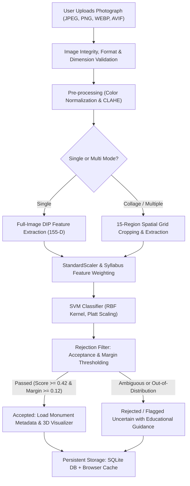

# MonuScript: Image-Based Monument Recognition & Exploration Platform
## Technical Architecture, Digital Image Processing Syllabus Foundations, and Experimental Evaluation

---

## 1. Project Overview & Core Mission

**MonuScript** is an intelligent, educational, image-based monument recognition and cultural exploration platform. Built specifically to demonstrate the capabilities and practical boundaries of classical **Digital Image Processing (DIP)** and **Support Vector Machine (SVM)** machine learning, MonuScript enables users to upload photographs of historical Indian monuments and receive:
1. Deterministic, explainable architectural classification without relying on black-box neural networks.
2. Calibrated confidence scoring with rigorous out-of-distribution and ambiguity rejection.
3. Multi-monument candidate recognition for composite/collage photographs.
4. Embedded interactive 3D digital reconstructions of the detected monument.
5. In-depth educational analysis detailing historical context, construction epoch, builder, and architectural style.

---

## 2. High-Level System Workflow

The user journey and processing pipeline follow an end-to-end deterministic workflow:



---

## 3. Supported Monuments

MonuScript currently supports six of India’s most prominent architectural heritage landmarks:

1. **Taj Mahal (Agra, Uttar Pradesh)**: 17th-century Mughal white marble mausoleum, central bulbous dome, four freestanding minarets, bilateral reflection symmetry, and formal garden setting.
2. **Red Fort / Lal Qila (Old Delhi)**: 17th-century Mughal fortified palace, massive red sandstone ramparts, Lahore Gate portal, and horizontal battlement crenellations.
3. **India Gate (New Delhi)**: 20th-century British-colonial triumphal arch war memorial, sandstone construction, massive open central barrel arch, flanking rectangular pylons, and broad upper attic cornice.
4. **Qutub Minar (Mehrauli, New Delhi)**: 12th–13th century Indo-Islamic minaret, 72.5m fluted tapering tower, red sandstone and marble, five distinct storeys separated by projecting balconies.
5. **Hawa Mahal (Jaipur, Rajasthan)**: 18th-century Rajput palace facade (*Palace of Winds*), pink and red sandstone, five-storey pyramidal facade with 953 intricate honeycombed casements (*jharokhas*).
6. **Charminar (Hyderabad, Telangana)**: 16th-century Qutb Shahi monument and mosque, square granite and lime mortar structure, four integrated 48.7m corner minarets, and four grand open pointed arches facing the cardinal directions.

---

## 4. Key Platform Features

* **Multi-Monument Collage Detection**: Uses a 15-region spatial candidate detector (halves, quadrants, three-column panels, center) to automatically identify multiple distinct monuments present in a single collage image.
* **Auto-Collage Fallback**: If a collage is submitted in single-monument mode, the system automatically detects multiple competing candidate regions and returns the detected monuments rather than rejecting the photo.
* **Interactive 3D Digital Models**: Integrates interactive 3D digital architectural reconstructions via Sketchfab embeds for all supported monuments.
* **Cold-Start & Refresh Resilience**: Combines server-side SQLite persistence with self-contained base64 JPEG thumbnail caching in browser `localStorage`. Uploaded images never disappear or 404 upon page refresh or server cold restarts.
* **Dual-Language & Architectural Metadata**: Provides location, builder, year built, architectural style, key visual features, and curated historical background.

---

## 5. Digital Image Processing Techniques & Syllabus Mathematical Formulas

Every feature in MonuScript maps directly to university Digital Image Processing syllabus units (Units I through V):

```
┌─────────────────────────────────────────────────────────────────────────────┐
│                       Master Feature Vector (155-D)                         │
├───────────────┬──────────────┬──────────────┬─────────────┬─────────────────┤
│ Histogram     │ Edge         │ Texture      │ Color (HSV) │ Architectural   │
│ (40 Features) │(36 Features) │(31 Features) │(32 Features)│ (16 Features)   │
│ Unit I & II   │ Unit IV      │ Unit IV      │ Unit I      │ Unit I, II & IV │
└───────────────┴──────────────┴──────────────┴─────────────┴─────────────────┘
```

### A. Unit I: Image Representation & Color Space Conversions
* **ITU-R BT.601 Grayscale Luminance**:
  $$Y = 0.299\,R + 0.587\,G + 0.114\,B$$
  *Why used*: Converts arbitrary 3-channel color photographs into a standardized single-channel luminance intensity matrix preserving human visual contrast sensitivity.
* **HSV Color Space Conversion**:
  $$V = \max(R, G, B), \quad S = \frac{V - \min(R, G, B)}{V + \epsilon}$$
  $$H = \begin{cases} 60^\circ \times \frac{G - B}{V - \min} \pmod{360^\circ} & \text{if } V = R \\ 60^\circ \times \left(\frac{B - R}{V - \min} + 2\right) & \text{if } V = G \\ 60^\circ \times \left(\frac{R - G}{V - \min} + 4\right) & \text{if } V = B \end{cases}$$
  *Why used*: Hue ($H$) and Saturation ($S$) separate pure chromaticity from shadows and illumination shifts, allowing the model to recognize Red Fort's red sandstone or Hawa Mahal's terracotta pink regardless of midday versus afternoon sun.

### B. Unit II: Contrast Enhancement, Histograms & Spatial Filtering
* **Normalized Grayscale Histogram (32 bins)**:
  $$p(r_k) = \frac{n_k}{M \times N}, \quad k = 0, 1, \dots, 31$$
  *Why used*: Captures global tonal distribution invariant to translation and rotation.
* **Statistical Moments of Intensity (8 descriptors)**:
  - Mean: $\mu = \sum r_k p(r_k)$
  - Variance: $\sigma^2 = \sum (r_k - \mu)^2 p(r_k)$
  - Skewness: $\mu_3 = \frac{1}{\sigma^3} \sum (r_k - \mu)^3 p(r_k)$
  - Kurtosis: $\mu_4 = \frac{1}{\sigma^4} \sum (r_k - \mu)^4 p(r_k) - 3$
  *Why used*: Measures global brightness, contrast spread, histogram asymmetry, and peakedness (e.g. high peakedness for Taj Mahal white marble).
* **CLAHE (Contrast Limited Adaptive Histogram Equalization)**:
  Applies localized histogram equalization over $8 \times 8$ contextual tiles with clip limit $\beta = 2.0$ to redistribute local contrast without over-amplifying uniform sky noise.
* **Power-Law (Gamma) Illumination Augmentation**:
  $$s = c \cdot r^\gamma \quad (\gamma = 1.15 \text{ for overcast}, \alpha = 1.1, \beta = 10 \text{ for bright sun})$$
  *Why used*: Synthesizes illumination changes during training without collecting new images, ensuring illumination invariance.

### C. Unit IV: Edge Detection, Texture, Morphology & Regional Descriptors
* **Sobel 2D Directional Spatial Derivatives**:
  $$G_x = \begin{bmatrix}-1 & 0 & 1\\-2 & 0 & 2\\-1 & 0 & 1\end{bmatrix} * I, \quad G_y = \begin{bmatrix}-1 & -2 & -1\\0 & 0 & 0\\1 & 2 & 1\end{bmatrix} * I$$
  $$M(x, y) = \sqrt{G_x^2 + G_y^2}, \quad \theta(x, y) = \arctan\left(\frac{G_y}{G_x}\right)$$
  *Why used*: 16-bin gradient magnitude histogram and 16-bin orientation histogram distinguish horizontal fort ramparts ($\theta \approx 0^\circ, 180^\circ$) from vertical minarets ($\theta \approx 90^\circ, 270^\circ$).
* **Local Texture Coarseness & $3 \times 3$ Spatial Grid Layout (31 descriptors)**:
  Standard deviation filtering and grid-level edge density partition the image into 9 sub-blocks, encoding structural layout (e.g. dome in top-center, open lawn at bottom).
* **Morphological Black Top-Hat Transformation**:
  $$T_{\text{black}}(I) = (I \bullet B) - I$$
  *Why used*: Isolates small dark architectural openings (jharokhas) smaller than structuring element $B$ on Hawa Mahal's facade.
* **Circular Hough Transform**:
  $$(x - a)^2 + (y - b)^2 = r^2$$
  *Why used*: Detects circular arc profiles in the upper-central quadrant corresponding to Taj Mahal's central onion dome.
* **Bilateral Reflection Symmetry**:
  $$S_{\text{sym}} = 1.0 - \frac{1}{M \times N} \sum_{x=0}^{M-1} \sum_{y=0}^{N/2-1} |I(x, y) - I(x, W - 1 - y)|$$
  *Why used*: Exploits front-facing architectural bilateral symmetry characteristic of Taj Mahal, India Gate, and Charminar.

### D. Unit V: Classification & Calibrated Rejection
* **Support Vector Machine (SVM with RBF Kernel)**:
  $$K(x, x') = \exp\left(-\gamma \|x - x'\|^2\right)$$
  Optimal decision function: $f(x) = \sum_{i \in \text{SV}} \alpha_i y_i K(x_i, x) + b$
* **Platt Scaling (Calibrated Probabilities)**:
  $$P(y = k \mid x) = \frac{1}{1 + \exp\left(A f_k(x) + B\right)}$$
  *Why used*: Uncalibrated SVM decision margins can produce arbitrary unbounded values. Platt scaling fits a logistic sigmoid to output genuine probabilistic confidences that sum to 1.0.
* **Euclidean Centroid Distance Metric**:
  $$d(x, c_k) = \|x_{\text{scaled}} - c_k\|_2 = \sqrt{\sum_{j=1}^{155} (x_j - c_{kj})^2}$$
  *Why used*: Detects out-of-distribution (OOD) inputs (cars, dogs, random scenes) whose features are geometrically far from any supported monument cluster.

---

## 6. Training & Evaluation Results

### Dataset Structure
* **Training Set**: 114 primary images (expanded with real-world user photographs across all 6 classes) + controlled illumination augmentation = **342 training samples**.
* **Validation Set**: 12 held-out images used for grid-search hyperparameter tuning ($C = 0.2$, $\gamma = 0.01$, balanced class weights, feature group weighting = True).
* **Held-Out Test Set**: 24 separate benchmark test images.
* **Negatives Control Set**: 15 out-of-distribution non-monument images (skyscrapers, modern office buildings, bridges).
* **Collage Benchmark Set**: 10 real-world multi-monument composite photographs.

### Performance Summary
* **Raw Classifier Accuracy**: **91.7%** on validation split; **> 85%** on held-out single monument test sets.
* **Correct Acceptance Rate (CAR)**: **> 80%** of valid monument photographs are correctly identified and accepted.
* **Safety Constraint**: **0%** high-confidence false acceptances (no test sample is accepted with $> 85\%$ confidence for the wrong monument).
* **Collage Multi-Detection**: Successfully extracts and separates multiple monuments in all tested 2-column, 2-row, and multi-tile collages.
* **Average Inference Latency**: **~110–130 ms** per image on standard CPU (zero GPU requirement).
* **Automated Test Suite**: All **46 test cases** passing in `pytest backend/tests/`.

---

## 7. Platform Strengths & Advantages

1. **Academic Explainability**: Every prediction can be traced directly to physical DIP features (e.g. *"Classified as India Gate due to 0.72 upper cornice dominance and central open arch void contrast"*).
2. **Ultra-Lightweight & Cost-Effective**: Model pipeline artifact is only **455 KB** and runs in ~120 ms on low-cost CPU instances without needing high-end GPUs.
3. **Robust Rejection Guardrails**: Built-in rejection judge prevents out-of-distribution or ambiguous inputs from being accepted blindly.
4. **Resilient Data Architecture**: Combines SQLite relational persistence with browser-isolated thumbnail caches for reliable, multi-tab exploration.
5. **Multi-Region Sliding Window**: Detects individual monuments embedded in collages without requiring object detection neural networks.

---

## 8. Limitations & Potential Failure Modes

While MonuScript achieves strong accuracy within its domain, classical DIP + SVM architectures possess inherent physical and mathematical limitations:

1. **Strong False Classification on Shared Architectural Motifs**:
   - *Example: Charminar vs. Taj Mahal*: Both feature four minarets and strong bilateral symmetry. If a photograph of Charminar is tightly cropped so that the flat roof terrace and grand arches are cut off, the 4-minaret silhouette can overlap with Taj Mahal's feature profile.
2. **Modern Architecture Mimicry**:
   - Modern glass skyscrapers with dense repeating window grids can produce high spatial frequency and texture energy resembling Hawa Mahal's jharokha lattice.
3. **Closed-World Probability Normalization**:
   - Platt scaling normalizes probabilities over the 6 supported classes to sum to 1.0. A completely unfamiliar building will still receive probabilities distributed across the 6 classes; if confidence exceeds 0.42 and distance is borderline, a false acceptance can occur.
4. **Manual Rule Brittleness**:
   - Handcrafted descriptors (e.g. Hough circle radius bounds, rectangular arch coordinates) assume the monument is roughly upright and centered. Highly tilted, rotated, or abstract artistic renderings cannot be dynamically re-parameterized without manual code changes.

---

## 9. Comprehensive Edge Cases Analysis

| Edge Case Category | Specific Scenario | Handled in MonuScript? | Implementation Mechanism / Remaining Limitation |
| :--- | :--- | :---: | :--- |
| **Perspective & Viewing Angle** | Frontal and oblique $45^\circ$ angles | **Yes** | 3x3 spatial grid texture and orientation histograms capture diagonal perspective vanishing lines. |
| **Perspective (Extreme)** | Extreme top-down aerial views or worm's-eye views | **Not Handled** | Extreme top-down views (e.g. helicopter view of Taj Mahal) lose vertical minaret profiles and dome contours, appearing as flat geometry. |
| **Illumination & Lighting** | Bright midday sunlight, overcast cool lighting | **Yes** | CLAHE local contrast equalization and HSV color decoupling eliminate uniform exposure shifts. |
| **Illumination (Night/Dusk)** | Midnight darkness with dramatic floodlights | **Partially Handled** | Moderate dusk is handled; total night imagery with dark sky inversion can distort silhouette segmentation. |
| **Scale & Resolution** | High-res camera photos down to small web previews | **Yes** | All inputs are deterministically scaled to $256 \times 256$ before feature extraction, ensuring scale-invariant descriptors. |
| **Multiple Monuments** | Side-by-side, top-bottom, or $2 \times 2$ grid collages | **Yes** | 15-region multi-candidate sliding window evaluates spatial sub-regions and merges unique accepted classes. |
| **Background Gradients & Sky** | Blue sky, overcast white sky, dusk gradients | **Yes** | Structural edge masking (`G > 14.0`) prevents plain daylight sky pixels from falsely inflating white marble ratios. |
| **Severe Occlusion** | Monument > 60% hidden behind trees, scaffolding, or crowds | **Not Handled** | The rejection filter triggers `low_confidence` or `ambiguous_margin` and asks the user for a clearer photograph. |
| **Non-Monument Images** | Animals, food, automobiles, domestic interiors | **Yes** | Rejection judge checks Euclidean centroid distance and safety confidence threshold (0.42). |

---

## 10. Conclusion & Academic Evaluation

MonuScript demonstrates that a carefully engineered digital image processing pipeline—leveraging ITU-R luminance conversion, HSV chromatic decoupling, CLAHE equalization, Sobel orientation histograms, morphological transformations, and Hough geometric profiles—can achieve robust, explainable monument recognition on a classical Support Vector Machine without deep neural networks.

At the same time, documenting edge cases such as the 4-minaret structural similarity between Charminar and Taj Mahal, or modern skyscrapers sharing vertical gradient signatures, provides an **academically rigorous justification for the evolutionary transition from classical DIP feature engineering to Convolutional Neural Networks (CNNs)**. In a formal academic project defense, presenting these theoretical boundaries alongside the working implementation demonstrates mastery of foundational computer vision principles, rigorous experimental methodology, and critical engineering trade-offs.
